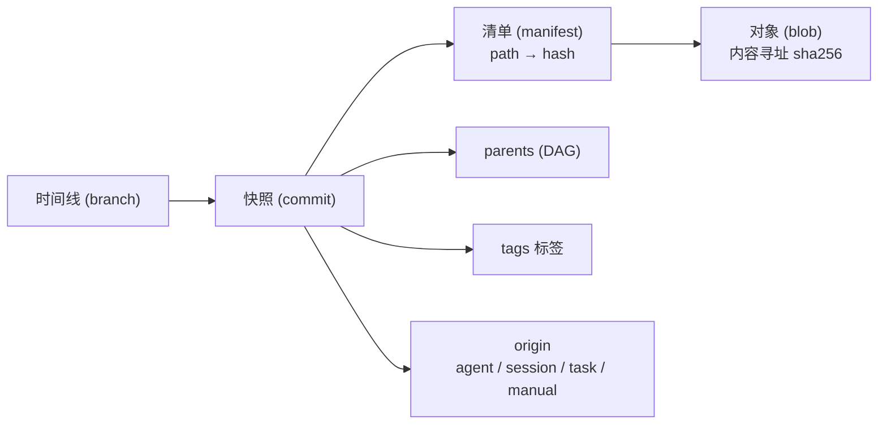
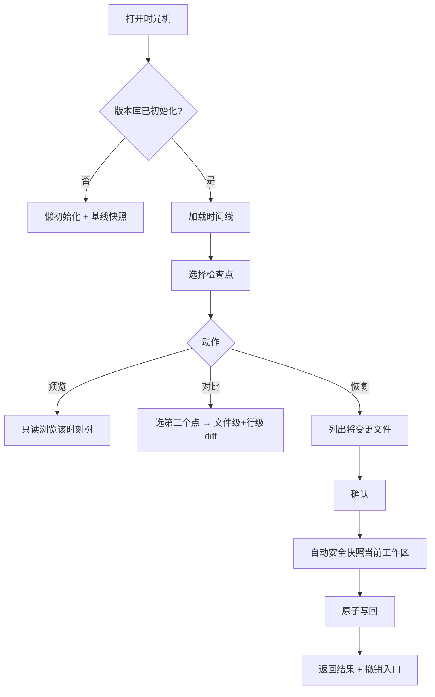

# 本地版本管理 & 项目时光机 · 功能 PRD

| 项 | 内容 |
|---|---|
| 文档状态 | **已批准**（D1–D7 全部按建议采纳，2026-09-20） |
| 目标仓库 | `D:\curvature`（Curvature — AI Agent Remote Access Gateway） |
| 交付形态 | 核心能力（Go 引擎 + HTTP API + 前端面板 + CLI），视图插件仅作展示层 |
| 预计里程碑 | M1 引擎 → M6 打磨（见 §11） |
| 前置勘察 | 已完成（前端/后端接入点，见 §14 附录） |

---

## 0. 一句话

给 Curvature 加一套**不依赖 git 的本地版本库**：把 agent 的每一次改动自动变成可回溯的检查点，并提供"项目时光机"——任意时刻的浏览、对比与一键恢复。

---

## 1. 背景与问题

### 1.1 现状

- Curvature 已具备多 agent 会话、任务板（worktree 隔离）、文件浏览器，以及 `gitview`（状态 / 分支 / worktree / diff）。
- 但 `backend/internal/gitview` **完全依赖本机 `git` 二进制**（`exec.CommandContext(ctx, "git", args...)`），且要求项目本身是 git 仓库。
- Agent 改代码的特征是：**高频、批量、跨文件、破坏性强**（重写、删文件、批量替换），且**不产生人类语义的 commit**。
- 于是"依赖 git 保护"在真实工作流里大面积失效。

### 1.2 问题清单

| # | 问题 | 后果 |
|---|---|---|
| P1 | 非 git 项目（临时目录、脚本仓、生成物目录）零保护 | agent 改坏后无法恢复 |
| P2 | agent 不做 commit，git 的保护形同虚设 | "安全切换"依赖人工纪律 |
| P3 | commit 是语义单元，粒度太粗 | 回不到"agent 第 3 次迭代" |
| P4 | 恢复单文件历史版本要懂 git 命令 | 门槛高，移动端不可用 |
| P5 | 危险操作（`rm -rf`、批量覆盖）前无检查点 | 事后无可挽回 |
| P6 | 多 agent / 多会话并行改同一目录 | 无隔离、无审计 |

### 1.3 为什么不是"再包一层 git"

- 仍然依赖外部 `git` 二进制 → P1 不成立。
- 非 git 项目需要 `git init`，侵入性大且会被用户与其他工具感知。
- git 的 index / stash 模型对"自动检查点"来说过重。
- 但**必须保留与 git 的互操作**，避免成为信息孤岛（列入 P2）。

---

## 2. 目标与非目标

### 2.1 目标

| # | 目标 | 说明 |
|---|---|---|
| **G1** | 零依赖 | 不要求项目是 git 仓库、不要求安装 git、不联网 |
| **G2** | 自动 | agent 工作中自动产生检查点，无需人工 commit |
| **G3** | 无损 | 任何回滚动作本身可回滚（回滚前自动安全快照） |
| **G4** | 直观 | 时间线 UI 闭环「看变更 → 看 diff → 预览 → 恢复」，移动端可用 |
| **G5** | 高效 | 二次快照必须增量（内容寻址去重 + stat 缓存） |
| **G6** | 可解释 | 每个检查点能回答"谁改的"（agent / 会话 / 任务 / 手动） |

### 2.2 非目标

- 不做远程推送与分布式协作（P2 仅做导入导出）
- 不做 3-way merge / 冲突解决 UI（并行时间线只切换，不自动合并）
- 不做二进制资产优化存储、不做完整 git 替代（rebase / 子模块 / hook 生态）
- 不自行加密（复用 Curvature 既有 E2EE 与本地访问控制）

---

## 3. 用户与核心场景

**角色**：使用 Curvature 驱动 agent 改代码的个人开发者（桌面 + 手机）。

### S1 · agent 改崩了

> Claude Code 重构了 8 个文件，测试全红。打开时光机，找到"重构前"的检查点，点「预览」确认文件内容，点「恢复整个项目」。系统**先自动把当前状态存为检查点**，再回滚。后悔了？再恢复回刚才那个安全检查点。

### S2 · 找回被删的文件

> agent 误删 `internal/auth/token.go`。对该路径打开「文件历史」，找到删除前的最后一个版本，单文件恢复。

### S3 · 对比两次迭代

> 想看 agent 第 2 轮和第 4 轮之间到底改了什么。时间线选中两个检查点 → 「对比」，得到文件级列表 + 行级 diff。

### S4 · 并行试错

> 让 agent 做方案 A 的同时，从同一时刻拉一条时间线做方案 B。两条线各自快照，随时切换。

### S5 · 非 git 项目

> 一个 `~/scratch/gen-config` 目录不是 git 仓库。Curvature 打开即用版本管理，agent 乱改也能回。

### S6 · 危险操作前保险

> agent 即将执行大范围删除 / 覆盖。系统在命令执行前自动打一个检查点。

---

## 4. 领域模型



| 概念 | 定义 |
|---|---|
| **快照 (Snapshot / Commit)** | 某一时刻整个项目树的只读记录，含父指针、消息、来源、统计 |
| **清单 (Manifest)** | `路径 → 内容哈希` 的扁平映射，快照的实体 |
| **对象 (Object)** | 内容寻址的文件内容（blob），sha256 去重 |
| **引用 (Ref)** | `HEAD` + 时间线（分支）+ 标签 |
| **检查点 (Checkpoint)** | 带来源标记的快照（auto / manual / task / branch） |
| **工作区状态 (Status)** | 当前文件树相对 HEAD 的差异 |

---

## 5. 功能需求

优先级：`P0` 必须（首个可用版本）· `P1` 重要 · `P2` 增强

### FR-1 仓库与初始化 `P0`

| # | 需求 |
|---|---|
| FR-1.1 | 每个项目根拥有独立版本库，默认 `<metaDir>/versioning/`；**必须同时兼容 project-local `.curvature` 与 home 模式 `~/.curvature/<rootId>`** |
| FR-1.2 | **懒初始化**：首次快照或打开面板时自动创建，无需用户操作 |
| FR-1.3 | 默认排除 `.git/`、`.curvature/`、`node_modules/` 等 |
| FR-1.4 | 忽略规则 = 内置默认 + 根 `.gitignore` + 根 `.versioningignore` |
| FR-1.5 | 单文件限额（默认 16 MiB）与总量限额，超限跳过并在快照统计里报"跳过 N 个" |

### FR-2 快照 `P0`

| # | 需求 |
|---|---|
| FR-2.1 | 手动快照：一条消息 + 可选标签 |
| FR-2.2 | 内容寻址去重：相同内容只存一份 |
| FR-2.3 | 增量扫描：`size + mtime` 命中则复用哈希，不重读内容 |
| FR-2.4 | 幂等：内容无变化时不产生空快照（除非显式强制） |
| FR-2.5 | 原子性：对象先落盘 → 清单 → commit → 最后原子更新 ref，崩溃不产生半个快照 |

### FR-3 自动检查点 `P0`

| # | 需求 |
|---|---|
| FR-3.1 | 触发点：会话开始 / agent 一轮结束 / **危险命令执行前** / 任务板任务起止 / 定时 / 手动 |
| FR-3.2 | 每个检查点记录来源：`{kind, agent, session_id, task_id, label}` |
| FR-3.3 | 去抖与节流：默认最短间隔 30s，内容无变化则跳过 |
| FR-3.4 | 设置中可开关与调参 |

### FR-4 时间线 `P0`

| # | 需求 |
|---|---|
| FR-4.1 | 全局时间线：按天分组，卡片显示时间、消息、来源徽标、变更文件数 `+A/-D` |
| FR-4.2 | 游标分页，默认 50 条 |
| FR-4.3 | 单文件历史：列出所有影响该路径的检查点 |
| FR-4.4 | 重命名追踪（`P2`，简化实现：按内容哈希匹配） |

### FR-5 差异与预览 `P0`

| # | 需求 |
|---|---|
| FR-5.1 | 快照 vs 父快照：文件级变更列表 + 行级 diff |
| FR-5.2 | 任意两快照对比（from/to） |
| FR-5.3 | 工作区 vs 任意快照（"我离那个时刻差多少"） |
| FR-5.4 | 只读预览：浏览任意快照下的完整目录树与文件内容 |
| FR-5.5 | 二进制文件不显示行 diff，显示"二进制文件（大小 A → B）" |
| FR-5.6 | 大 diff 截断保护，避免前端卡死 |
| **FR-5.7** | **统一 diff 输出必须是 git 兼容格式**（`diff --git`、`--- a/`、`+++ b/`、`@@ -l,s +l,s @@`），以复用前端既有解析器（见 §14.1） |

### FR-6 恢复 / 时光机跳跃 `P0`

| # | 需求 |
|---|---|
| FR-6.1 | 恢复范围：整个项目 / 某个目录 / 单个文件 |
| FR-6.2 | **回滚保护**：恢复前自动对当前工作区打安全快照，结果返回该快照，UI 提供「撤销这次恢复」 |
| FR-6.3 | 恢复语义二选一：<br>「覆盖工作区」= 只改文件不动历史，留下 dirty 状态<br>「时光机跳跃（Revert）」= 生成内容等于目标时刻的**新快照**，历史只前进、绝不重写 |
| FR-6.4 | 恢复前展示将变更的文件清单，需用户确认 |
| FR-6.5 | 恢复**原子化**：先写临时内容，失败整体回滚，不做半截恢复 |
| FR-6.6 | 删除类恢复（目标时刻不存在该文件）同样受保护 |

### FR-7 时间线并行 / 切换 `P1`

| # | 需求 |
|---|---|
| FR-7.1 | 从任意快照创建命名时间线（分支） |
| FR-7.2 | 切换时间线 = 设 HEAD + 恢复工作区（带回滚保护） |
| FR-7.3 | 列出时间线，显示其 HEAD 与最新消息 |
| FR-7.4 | **不做自动合并**；工作区脏时必须提示并先安全快照 |

### FR-8 标签 / 书签 `P1`

| # | 需求 |
|---|---|
| FR-8.1 | 给任意快照打标签，可删除 |
| FR-8.2 | 时间线中标签高亮，可一键跳转 |

### FR-9 存储治理 `P1`

| # | 需求 |
|---|---|
| FR-9.1 | 展示版本库体积、对象数、快照数 |
| FR-9.2 | GC：清理不被任何快照引用且超过保留期的对象 |
| FR-9.3 | 保留策略：按数量/天数保留**自动**检查点；手动与标签保护的不删 |
| FR-9.4 | 导出/导入项目历史包（`P2`） |

### FR-10 集成 `P0`

| # | 需求 |
|---|---|
| FR-10.1 | HTTP API（见 §8.5） |
| FR-10.2 | 前端「时光机」面板：时间线 + diff + 预览 + 恢复 |
| FR-10.3 | 文件树内嵌「该文件历史」入口，diff 复用现有渲染 |
| FR-10.4 | CLI：`curvature versioning <status\|snapshot\|log\|diff\|restore\|branches\|gc>` |
| FR-10.5 | 会话内可被 agent 调用，使 agent 自主"存档 / 回档" |
| FR-10.6 | **与 git 并存互不干扰**：版本库在 `.curvature/` 内，`git status` 结果不变 |
| **FR-10.7** | **设计约束**：时光机面板必须为独立组件，`App.tsx` 侧只允许「一个 state 标志 + 一个分支 + 一个菜单项」三处最小改动（见 §14.1 / R5） |

### FR-11 视图插件（展示层）`P2`

| # | 需求 |
|---|---|
| FR-11.1 | 提供 `plugins/version-timemachine.js`，在文件查看器中渲染导出的时间线 / 快照清单 |
| FR-11.2 | **边界说明**：现有插件契约是纯函数式前端视图插件（无 IO、无网络、无文件写入、有信任门禁），**无法单独实现版本管理**；因此版本管理主体必须是后端能力，插件只是展示层 |

---

## 6. 交互设计

### 6.1 桌面布局

```
┌ 项目时光机 ─────────────────────────────────────────────┐
│ [时间线: main ▾] [标签] [新建快照] [设置]                 │
├──────────────┬──────────────────────────────────────────┤
│ ● 14:32 自动  │  消息 / 来源 / 时间 / +6 -2               │
│ │  +6 -2     │  ┌ 变更文件 ─────────────────────────┐    │
│ ● 14:05 手动  │  │ M internal/auth/token.go   +12 -3 │    │
│ │  +2 -0     │  │ A internal/auth/refresh.go +40 -0 │    │
│ ● 13:40 跳跃  │  └───────────────────────────────────┘    │
│              │  ┌ 行级 diff ─────────────────────────┐    │
│              │  │ - old line                          │    │
│              │  │ + new line                          │    │
│              │  └───────────────────────────────────┘    │
│              │  [预览该时刻] [对比…] [恢复…]              │
└──────────────┴──────────────────────────────────────────┘
```

移动端：时间线为全屏列表 → 点入详情页 → 底部操作条。

### 6.2 关键流程



---

## 7. 技术方案概览

### 7.1 存储布局

```
<metaDir>/versioning/
  HEAD                 → "ref: refs/heads/main"
  config.json          → {format, created_at, limits, ignore}
  objects/ab/cdef…     → zlib( "<kind> <size>\x00" + payload )
  refs/heads/main      → commit hash
  refs/tags/<name>     → commit hash
  cache/stat.json      → path → {size, mtime, hash}   增量扫描
  lock                 → 跨进程互斥
```

### 7.2 对象模型

| 类型 | 内容 |
|---|---|
| `blob` | 文件内容（按字节流，**不假设 UTF-8**） |
| `tree` | 清单 JSON：`{entries:{path:{hash,size,mode,binary}}}` |
| `commit` | `{hash, parents[], tree, message, author, created_at, origin, stats}` |

> **设计取舍（D2）**：清单使用**扁平 map** 而非 git 式层级 tree。牺牲目录级去重（占比极小），换取实现简单、diff 直出。blob 级去重已覆盖绝大多数空间收益；`config.format` 预留升级位。

### 7.3 关键算法

- **内容寻址**：sha256，写入走 temp + rename，读取时校验哈希，损坏即报错
- **增量扫描**：`size + mtime` 命中则复用哈希，否则读内容算哈希
- **diff**：自研 Myers `O(ND)`（前后缀裁剪 + D 上限，超限降级为整文件替换）
- **二进制判定**：NUL 启发式（前 8000 字节内出现 NUL）
- **忽略规则**：内置默认 + gitignore 子集（`**`、前导 `/`、尾随 `/`、`!` 取反）
- **恢复**：全部写临时文件 → 校验 → 原子 rename 批量提交，失败整体回滚

### 7.4 并发与完整性

- 进程内按 store 目录 key 化的互斥锁 + 文件锁（跨进程）
- 所有元数据写入走 temp + rename
- 崩溃安全：对象 → 清单 → commit → ref **单调推进**；悬挂对象无害，由 GC 清理
- 路径安全：拒绝绝对路径、`..` 穿越、符号链接不跟随；恢复范围严格限定项目根内

### 7.5 HTTP API 草案

> 约定：项目根参数名为 **`root`**（非 `root_id`）；查询参数与 JSON body 均为 **snake_case**。

```
GET    /api/versioning/info?root=
GET    /api/versioning/status?root=
POST   /api/versioning/snapshot   {root, message, tag?, origin?}
GET    /api/versioning/log?root=&limit=&branch=&before=
GET    /api/versioning/timeline?root=&path=&limit=
GET    /api/versioning/changes?root=&from=&to=
GET    /api/versioning/diff?root=&from=&to=&path=
GET    /api/versioning/file?root=&rev=&path=
GET    /api/versioning/tree?root=&rev=&dir=
POST   /api/versioning/restore    {root, rev, paths?, mode:"overwrite"|"revert"}
GET    /api/versioning/branches?root=
POST   /api/versioning/branch     {root, name, from?}
POST   /api/versioning/checkout   {root, name}
GET/POST/DELETE /api/versioning/tags
POST   /api/versioning/gc         {root, keep_days?, keep_count?}
```

---

## 8. 实现约束（基于代码勘察，锁定）

### 8.1 关键工程决策：零侵入接入

后端勘察发现 `usecase.Registry` 接口由 **5+ 个测试 fake 实现**：
`uploadTestRegistry`（`usecase_test.go:2018`）、`commandTestRegistry`（:2165）、`multiRootSearchTestRegistry`（:2223）、`renameManagedDirTestRegistry`（:2289）、`syncDeltaTestRegistry`（`external_sessions_test.go:334`）。
**一旦扩宽接口，这些全部编译失败。**

> **对策**：版本管理只依赖接口上**已存在**的 `GetRoot(rootID) (fs.RootInfo, error)`。Store 实例用 `versioning` 包内的**包级缓存**（按 store 目录路径 key 化，内含互斥锁与 stat 缓存），**不新增 `AppContext` 字段、不修改 `Registry` 接口**。

**净效果**：backend 侧改动 = 新增 1 个包 + 1 个 usecase 文件 + `Routes()` 内约 15 行路由。

### 8.2 已确认的接入事实

| 项 | 事实 | 用法 |
|---|---|---|
| 路由 | go-chi v5；`Routes()` 位于 `http.go:280-397` | 在其内追加 `r.Get/Post("/api/versioning/…", h.protectedEndpoint(h.handleXxx))` |
| 鉴权 | `/api/*` **无 token 鉴权**；`protectedEndpoint` 做 E2EE 门禁（未启用则直通） | 版本管理暴露项目内容 → **全部包 `protectedEndpoint`** |
| 响应 | `respondJSON` / `respondError` / `errInvalidRequest`（`helpers.go:11-41`） | 直接使用 |
| usecase | `h.service()` → `&usecase.Service{Registry: h.AppContext}`（`http.go:73`） | 新增 `usecase/versioning.go` |
| 元数据目录 | `RootInfo.MetaDir()` **可能返回空串**（`fs.go:189`）；`EnsureMetaDir()` 才保证创建（`fs.go:219`）；有 project / home 双模式 | store 走 `EnsureMetaDir()/versioning`，**两种模式都要能跑** |
| git 隔离 | `.curvature` 已被 `gitview.shouldIgnoreStatusPath`（`gitview.go:861`）过滤，且 `ensureProjectMetaExcluded`（`fs.go:247`）会写入 `.git/info/exclude` | ✅ FR-10.6 **天然成立，零额外工作** |
| 编码 | `fs.ReadFile` + `TryDecodeText` 处理 UTF-16 / GB18030 | 快照**按字节流**处理，绝不假设 UTF-8 |
| 依赖 | 无 go-git；`crypto/sha256` 已在 e2ee / update / relay 中使用 | ✅ 纯标准库，`go.mod` **零变更** |
| 错误 | `apperr.Wrap(op, path, err)`，op 用小写动词 | 统一使用 |
| 测试 | 白盒 `package api`，`httptest.NewRequest` + `httptest.NewRecorder`；**无 `Routes()` 级测试先例** | 引擎用 `t.TempDir()` 全量单测；handler 直调测试 |

### 8.3 已知取舍

`protectedEndpoint` 会**缓冲并 JSON 往返整个响应体**。因此 `GET /api/versioning/file`（历史文件预览）默认走 JSON 内嵌 content（与 `/api/file` 的 JSON 分支一致），并**加大小上限**（默认 1 MiB，超限返回元信息 + 截断标志），避免大文件打爆内存。若后续需下载大文件，再仿 `/api/file?raw=1` 的 `io.Copy` 旁路模式。

### 8.4 前端接入（锁定）

| 项 | 结论 |
|---|---|
| **无路由** | 靠 URL query（`root`/`file`/`session`/`cursor`/`vp_*`）+ `workspaceView` 的 if/else 链选择视图 |
| **挂载方式** | 新增 state 标志 + 在 `App.tsx:13354`（`gitDiff` 分支前）插入分支；入口加进 `MainContentViewMode` 菜单（`DefaultListView.tsx:15` + `:817`） |
| **状态管理** | **无 Redux / Zustand / Context**（仅 i18n），状态全在 `App.tsx` 单组件 |
| **服务层** | 仿 `services/git.ts`：`protectedJSON(appURL("/api/…", params))`，错误抛 `ProtectedAPIError`，UI 用 `reportError()` |
| **时间线 UI** | 复用 `GitHistoryPanel` 的 dot + 竖线视觉（`GitHistoryPanel.tsx:126-151`） |
| **diff 渲染** | 复用 `gitDiffModel.ts` 的 `buildDiffLines` / `buildUnifiedRows` / `buildSideBySideRows`（**已有单测**）+ `GitDiffViewer` 的样式 |
| **i18n** | `zh-CN.ts` 是 `MessageKey` 的**类型源头**，新键必须**中英双写** |
| **样式** | Tailwind 已装但**不用于 app UI**；app 全是 inline style + CSS 变量。无 `components/ui/` 原语 |
| **验证命令** | `npm run typecheck` → `npm run build`；纯逻辑测试放 `web/tests/*.test.mjs`，跑 `node --test tests\` |

---

## 9. 已决策项（2026-09-20 批准）

| # | 决策 | 结论 | 状态 |
|---|---|---|---|
| **D1** | 自研存储 vs 基于 git | **自研**（纯标准库、零依赖、已确认无 go-git） | ✅ 采纳 |
| **D2** | 清单扁平 vs 层级 tree | **先扁平**，`config.format` 预留升级 | ✅ 采纳 |
| **D3** | 恢复默认语义 | **时光机跳跃（Revert）**，历史只前进 | ✅ 采纳（曾长期只是名义默认，已补齐 —— 见下） |
| **D4** | 交付形态 | **核心能力** + 插件仅展示层 | ✅ 已由代码证据确认 |
| **D5** | 自动检查点默认 | **默认开启 + 30s 去抖** | ✅ 采纳 |
| **D6** | FR-3 自动检查点优先级 | **从 P1 提到 P0** | ✅ 采纳（见 §5 FR-3） |
| **D7** | `types.go` / `util.go` 草稿 | **保留**，按 M1 重写扩展 | ✅ 采纳 |
| **D8** | 自动检查点的保留策略（原 Q4） | **自动检查点走独立时间线**（独立 ref），保留策略 = 把该 ref 回退 N 个提交 + GC；**不改写 DAG，主分支与安全存档不受影响** | ✅ 采纳（有测试证据，见下） |
| **D9** | 是否做文件级自动检查点（原 Q1） | **不做**。自动检查点保持快照整棵工作树；stat cache 已把未改动文件的成本压到接近零，文件级方案会拿掉「整树一致」保证、把检查点降级为增量记录，得不偿失 | ✅ 采纳（**依据是结构推理 + stat cache 测试，未做大仓库基准**，见 §13 Q1） |
| **D10** | 版本库位置（原 Q2） | **跟随 root 的元数据位置**，不提供独立的版本库位置设置；默认项目内 `<项目>/.curvature/versioning/` | ✅ 采纳（原文「默认全局」已更正，见 §13 Q2） |
| **D11** | 是否给 agent 暴露存档/回档工具（原 Q3） | **读 + 存档开放；回档（restore）与切时间线（checkout/branch）默认关闭，做成偏好开关**；`skip_safety` 永不对 agent 暴露 | ✅ 采纳（**护栏是协作式的，非安全边界**，见 §13 Q3） |

**D3 的落地过程（端到端实测发现 → 补齐）**：`revert` 曾长期只是「名义上的默认」—— 代码、界面与 CLI 的实际默认都是 `overwrite`；更糟的是 `revert` **没有实现 `Paths` 作用域恢复，也跳过了路径穿越校验**（`selectRestorePaths` 的第 4 个参数被传成 `mode == RestoreModeRevert`，该模式下直接返回整个并集，`normalizeRelPath` 根本没被调用）。也就是说 D3 里被当作「更安全」的模式，实际防护更弱。已修正三处：

1. **作用域与校验同模式解耦**：`selectRestorePaths` 去掉 `wholeTree` 参数，两种模式共用同一套选择与校验逻辑。
2. **提交「实际产生的树」**：`revert` 原本提交整个 `targetManifest`。全树恢复时这正确，但**作用域恢复下会声称未恢复的文件也已回滚**，使随后的 `Status` 谎报干净。改为 `mergeRestoredManifest`：以当前清单为底，只把 `wanted` 中的路径替换为目标版本（目标中不存在的则删除）。
3. **默认值改为 `revert`**（`normalizeRestoreMode`）。

覆盖测试：`TestScopedRestoreLeavesOtherPathsAlone` / `TestScopedRestoreDeletesOnlyInsideScope` / `TestRestoreRejectsPathsOutsideRoot` 改为**双模式**子测试；新增 `TestScopedRevertCommitsOnlyTheAppliedPaths`（断言作用域外文件在提交中未被回滚，且恢复后 `Status` 干净）；`TestRestoreRoundTrip` 显式传入 `overwrite`（其断言本就只对 overwrite 成立）。

---

## 10. 非功能需求

| 维度 | 要求 |
|---|---|
| **性能** | 10k 文件项目首次快照 < 15s；无变更增量快照 < 1.5s；时间线首屏 < 500ms |
| **存储** | 重复内容零增长；快照开销 ≈ 变更文件大小 + 少量元数据 |
| **兼容** | Windows / macOS / Linux；Go 1.25；**不新增第三方依赖** |
| **安全** | 路径穿越防护；不跟随符号链接；对象哈希校验；恢复严格限定项目根内 |
| **可观测** | 快照 / 恢复操作写入既有日志体系 |

---

## 11. 里程碑
| 阶段 | 内容 | 验收 |
|---|---|---|
| **M1** 引擎 | 对象库 / 清单 / 引用 / 忽略 / diff + 单测 | `go test ./backend/internal/versioning/...` 全绿 |
| **M2** 服务与 API | status / snapshot / log / diff / restore / timeline / branch / gc + HTTP | 全链路可用 |
| **M3** UI | 时光机面板 + 文件历史 + 恢复确认流 | 走通 S1 / S2 / S3 |
| **M4** 自动检查点 | 会话 / 任务事件挂钩 + 去抖 + 设置 | S6 生效 |
| **M5** CLI 与治理 | `curvature versioning …` + GC + 保留策略 | CLI 与 UI 结果一致 |
| **M6** 打磨 | 插件展示层、i18n、移动端、性能与文档 | 构建通过 + 文档齐备 |

#### 进度记录

- **M1 / M2 / M3 已完成**。M1 引擎 33 个测试全绿；M2 18 条 HTTP 路由 + 端到端测试通过；M3 前端 `tsc --noEmit` 与 `vite build` 均退出 0（复用现成的 `GitDiffViewer`，仅加 5 行状态码适配器）。
- **M4 部分完成**：`versioning/scheduler.go` 的去抖调度器与 7 个测试已全绿，`AppContext` 通过**可选接口**（而非扩宽 `Registry`）接住 usecase 的会话通知，会话钩子挂在恢复路径之后、持久化之前，`go build` / `go vet` 全通过。**用户开关已完成**（M4b）：偏好项 `versioning_auto_checkpoints_disabled`（**否定式存储**，零值即启用 = 默认开启）+ `GET/PUT /api/preferences/versioning-auto-checkpoints` + FileTree 设置面板开关；环境变量 `CURVATURE_AUTO_CHECKPOINTS=0` 保留为运维级强制关闭。调度器在**每次通知时**读取开关，因此切换立即生效、无需重启。**仍缺**：① ~~kanban 任务事件挂钩（M4c）~~ → **已完成，见下**；② M4 的接线无自动化测试覆盖 —— `go vet` 只证明能编译，未证明「agent 跑完后真的会产生检查点」。（②已在后续补齐：`versioning_auto_test.go` 用真实 `AppContext` + 可注入时钟端到端验证了「通知 → 去抖 → 无父提交 → origin 标签」全链路。）

- **M4c 已完成**：`kanban.TaskObserver` 可选接口 + `Service.SetObserver`，在任务进入终态时通知检查点调度器。
  - **过程中发现的关键点**：终态有**两条**路径 —— `finishTask`（成功，`Complete` 与调度器三处都走它）与 `setTaskStatus`（失败 / 取消）。我最初只挂了 `setTaskStatus`，测试立刻暴露「`Complete` 成功但观察者没被调用」。**只挂一处会静默漏掉所有成功完成的任务**，即最常见的那一类。现已两条路径都通过 `notifyTaskTerminal` 上报。
  - 读 `Observer` 时刻意不加锁：`finishTask` 可能已在调度器持锁路径上，加锁会死锁；`Observer` 启动后只设一次，与本文件既有的 `Runner` 读法一致。
  - 标签格式 `task:<taskID>:<status>`，与 `session:<id>` 区分开。
  - 测试：`TestTaskObserverFiresOnlyOnTerminalTransitions`（创建 / 暂停不得上报，完成恰好上报一次且带标签，`SetObserver(nil)` 后取消也不得上报）、`TestObserveTaskTerminalRecordsCheckpoint`、`TestObserveTaskTerminalWithoutIdentifiers`。
  - 注：该测试与既有 kanban 测试一样，在纯净基线上同样出现 `TempDir RemoveAll ... task-kanban.db` 清理错误 —— 既有环境问题，断言本身全部通过。

- **M3 无自动化测试**：仓库没有前端测试运行器（见 R6），类型检查与构建只证明「能编译能打包」，**未证明运行时行为正确**。
- **M4 接线已有测试**（补上了此前的缺口）：`api/versioning_auto_test.go` 5 个测试覆盖 provider 解析 → 通知 → 去抖 → 落盘 → origin 记录，以及偏好开关的门控与「开启后立即生效」、未知 root 不中断其余 root、环境变量只能强制关闭。
- **M5 全部完成**：`curvature <rootid> -versioning <info|status|log|snapshot|restore|gc|prune|verify>` 已实现（走 HTTP，与 UI 同源，故结果天然一致），测试覆盖参数归一化（`<rootid>` 在前需重排，否则 Go 的 flag 包会停止解析）与请求映射。保留策略见下。

- **M5b / M5c 已完成**：D8 保留策略（无父检查点 + `PruneCheckpoints` + HTTP/CLI 接线 + 保留数量偏好项 + 前端「自动检查点」标签页），并修掉两处真实缺陷 —— ① prune 后的 GC 套用 1 小时宽限期，导致**生产环境下实际零回收**（引擎测试当时显式传了 `GracePeriod: time.Nanosecond`，无意中绕过了被测的生产路径；已加 `GCOptions.Immediate` 并让 HTTP 测试断言 `removed > 0`）；② `Checkpoint: true` 未带 `Origin` 时提交无来源、前端会显示成「手动快照」（已隐含 `OriginAuto`）。
- **M6 已完成**：
  - ✅ **文档**：新增面向使用者的 [`local-versioning.md`](./local-versioning.md)（概念对照、三种历史互不干扰、保留策略、CLI、存储位置、回滚语义、开关、已知边界）。
  - ✅ **i18n**：`zh-CN` / `en-US` 双语键齐备（含检查点标签页、清理动作、历史内容预览）。
  - ✅ **插件展示层**：时光机的「文件时光机」标签页新增「预览此版本」，用**与实时文件浏览器相同的 view plugin 管线**渲染历史版本内容（老版 README 渲染成 Markdown、老版图片可显示等），无匹配插件或插件抛错时回退纯文本。
    - 做法上刻意**没有**把插件管线从 `App.tsx` 抽出成组件：该管线与实时文件状态（`file` / `cursor` / `pluginQuery` / `actionHandlers.open`）深度耦合，抽取属于 R5/FR-10.7 明确要避免的大改。改为由宿主注入 `renderHistoricalFile` 回调，面板通过 props 接收，`App.tsx` 只增加一个 `useCallback` 与一个 prop —— 插件管线仍只有一份。
  - ✅ **移动端适配**：面板三处固定宽度侧栏（320 / 340 / 280px）改为在 `max-width: 767px`（与 `GitDiffViewer`、`FileViewer` 一致的断点）下纵向堆叠，侧栏限高 45% 以保证详情区仍在屏内。内联样式没有媒体查询，故用 `useNarrowLayout()` hook 承载断点。
  - ✅ **大仓库性能**：把 `scanWorkingTree` 从「边遍历边串行哈希」改为**发现 → 并行哈希编码 → 串行装配**三段。
    - 并行度取 `min(NumCPU, 待处理数, 16)`；对象**落盘**串行化，读文件、帧化、zlib 压缩全部并行。
    - **过程中踩到一个真实 bug 并修掉**：我最初断言「并发写对象是安全的，因为 `atomicWriteFile` 用唯一临时名 + rename」。这是**错的** —— `writeObject` 先 `os.Stat` 判存在再写，两个 worker 持有相同内容时会**双双未命中**、双双 rename 到同一路径，Windows 上以共享冲突失败（`rename ...: Access is denied`）。全量套件立刻抓到（`TestRestoreDeletesFilesAddedAfterTarget`）。修法是把 `writeObject` 拆成 `encodeObject`（并行）+ `storeEncoded`（串行，含存在性检查），并新增 `TestConcurrentIdenticalContentSharesOneObject`（128 个同内容文件，断言只落 1 个 blob）直接复现该竞态，连跑 5 次稳定。
    - **stat cache 已存在且正确**：`hashFile` 原本就用 (size, mtime) 短路，并额外校验 `hasObject`，避免信任已被 GC 的 blob。新增 `TestStatCacheSkipsRehashingUnchangedFiles` 证明「未改动的树重扫时读取次数为 0，改一个文件只重读 1 个」——这条性质是 30s 自动检查点不至于每轮重读整仓库的前提。
    - 其余新增测试：`TestStatCacheMissesWhenObjectIsGone`、`TestScanHashWorkersStayBounded`、`TestParallelScanProducesIdenticalManifests`（并行不得改变结果）、`TestParallelScanReportsReadFailure`。
    - 未做：`-race` 无法在本机运行（`-race requires cgo`，无 C 工具链），故并发正确性靠定向测试覆盖而非竞态检测器。

- **收尾核查：分支式版本切换曾经够不到。** 目标要求「分支式版本切换」，而在 M6 完成后逐项核对可达性时发现：引擎（`CreateBranch` / `Checkout` / `Branches`）与 HTTP API（`GET|POST /api/versioning/branches`、`POST /api/versioning/checkout`）都完整，`web/src/services/versioning.ts` 的三个封装函数也早就写好，但**前端与 CLI 完全没有调用它们** —— 面板里唯一一处 `branch` 只是把 `status.branch` 当文本显示，CLI 的 action 列表里根本没有 `branch`/`checkout`。能力实现了却没有任何入口，等于没有。
  - 补齐 **CLI**：新增 `branches` / `branch` / `checkout` 三个 action 与 `-name` flag，并加了 `TestVersioningRequestSupportsTimelineSwitching`（含「省略 `-rev` 时不得发送空的 `from` 字段」这条边界）与 `TestTruncateRunesKeepsMultiByteTextIntact`。
  - 补齐 **UI**：面板状态栏加时间线下拉框与「新建时间线」按钮，切换前 `confirm` 说明会用该时间线覆盖工作区、未提交改动会先自动快照。
  - 顺带发现一个 **UX 陷阱**：`validateBranchName` 把名字限制为 `^[A-Za-z0-9][A-Za-z0-9._-]{0,63}$`（因为名字会成为 ref 的路径分量），**中文时间线名会被服务端 400 拒绝**，而最初的 prompt 文案没提。已把约束写进中英文 prompt 文案与用户文档，并在 API 测试里锁定该 400 行为。
  - 核查后的结论：**引擎侧的分支切换本来就有充分测试**（`TestBranchCreateAndCheckout` 覆盖了成功 checkout 后工作区内容与 current 标记的变化）；真正缺的是 API 成功路径与 UI/CLI 入口。API 成功路径已补 `TestVersioningTimelineSwitchingOverHTTP`（原测试只断言未知时间线返回 400，即便创建/切换完全坏掉也会通过）。

- **既有仓库问题（非本功能引入）**：`gofmt -l` 对 `cli/cmd/autostart_test.go`、`backend/internal/fs/shared_watcher.go`、`backend/internal/relay/{manager,service}.go`、`backend/internal/session/manager.go`、`backend/internal/tlsutil/cert.go` 报格式漂移。这些文件本功能未触碰，未修改。

### 验证命令

```powershell
go test ./backend/internal/versioning/...    # M1 引擎 + D8 保留策略（本沙箱可跑）
go test ./backend/...                        # 回归
go build ./...                               # 编译
cd web ; npm run typecheck ; npm run build   # M3 前端
```

---

## 12. 验收标准

- 非 git 目录中 agent 删 3 个文件 → 时间线可见 → 单文件恢复后**逐字节一致**
- 恢复整项目后能一键撤销回恢复前状态
- 连续 5 次快照中 4 次无变更 → 不产生新快照；有变更时增量 < 变更总量 × 1.2
- 10k 文件目录二次快照 < 1.5s（stat 缓存命中）
- `../../etc/passwd` 的预览 / 恢复请求被拒绝
- 故意损坏一个对象文件 → 读取报明确错误，而非静默返回错误内容

---

## 13. 风险与开放问题

### 风险

| # | 风险 | 对策 |
|---|---|---|
| **R1** | 与 git 语义混淆（用户以为分支能 merge） | UI 文案明确"本地检查点，不是 git" |
| **R2** | 大仓库扫描耗时 | stat 缓存 + 限额 + 后台异步快照 |
| **R3** | 自动快照噪音 | 去抖 + 无变更跳过 + 保留策略 |
| **R4** | 恢复覆盖未保存的编辑器内容 | 恢复前检查 dirty 并提示 |
| **R5** | `App.tsx` 是 ~15,000 行单文件单体，是唯一状态容器 | 面板做成独立组件（对标 `GitHistoryPanel` 的 278 行），`App.tsx` 仅三处最小改动 → FR-10.7 |
| **R6** | 前端无 lint / 无集成测试，CI 只跑 `npm ci && npm run build` | 可测逻辑抽成纯 `.ts` model，配 `web/tests/` 单测 |
| **R7** | 前端单测在本会话沙箱内不可执行（`node --test` fork 子进程需管道 stdio，沙箱禁止） | 可验证逻辑重心放 Go 侧；`web/tests` 需在放开权限的终端验证一次 |
| **R8** | 全量后端回归（`go test ./backend/...`）会真实触发 `commandexec` 的 `taskkill /PID <已退出 PID> /T /F`，并行进程 churn 下可能误杀无关进程树；实测导致本机 `curvature-server` 及 relay 掉线、会话中断 | 本功能的验证只跑 `go test ./backend/internal/versioning/ ./backend/internal/api/`，不在承载线上服务的机器上跑全量套件；缺陷本身见下方 B1 |

### 已登记的既有缺陷（非本功能引入）

**B1 — `taskkill` 缺少存活守卫，清理后台会误杀无关进程树 —— ✅ 已修复**

- 根因（确认无误）：`commandexec/process_windows.go` 的 `KillTree()` 直接执行 `taskkill /PID <pid> /T /F`，**不检查 `p.exited`**；文件内已有**三个**调用点自己在外面套了 `case <-p.exited:` 守卫（ConPTY / pipe 构造里的看门狗），但守卫从未进入 `KillTree` 内部，因此**经 `Process` 接口调用它的 `stopCommandProcess` 完全没有保护**。
- 顺序错误：`stopCommandProcess` 原为 `Interrupt → 2s → Terminate → 3s → KillTree`。`Terminate()` 先杀死根进程并释放 PID，3 秒后 `taskkill` 找到的可能是**复用者**，`/T` 会连同其子树一起杀。且此时子树已经不可枚举 —— 这一步既无用又危险。
- **关键区分**：`Terminate()` 用的是 **handle**（Windows）/ **进程组**（unix）—— handle 只要未关闭就不会被复用，所以 `Terminate` 对已退出进程是安全的；而 `KillTree()` 用的是**裸 PID**，进程一旦退出就不再属于我们。因此「守卫加在 `KillTree`、顺序把 `KillTree` 提到 `Terminate` 之前」是正确解法。
- 修法：
  1. `KillTree()` 内部新增 `hasExited()` 非阻塞检查，退出后直接返回；`taskkill` 之后再检查一次，避免竞态下走到按 PID 的兜底。
  2. `stopCommandProcess` 重排为 `Interrupt → 2s → KillTree → Terminate`（`KillTree` 在根进程存活时才能枚举子树，`Terminate` 降为兜底），并删掉了重排后已无意义的 3 秒等待。
  3. `process_unix.go` 的同类隐患**同样存在**（PGID 与 PID 一样会被复用，`kill(-pgid, SIGKILL)` 会带走整组），已加 `syscall.Kill(-pid, 0)` 存活探测，仅 `ESRCH` 时跳过（`EPERM` 表示存在但无权限，不应跳过）。此项**无法在本机编译验证**（linux 交叉构建需要联网拉取 `creack/pty`），故刻意只用 `err == syscall.ESRCH` 而非 `errors.Is`，以免引入未经编译验证的新 import。
  4. 新增 `taskkillCommand` 可注入变量，使「是否真的 shell out」可被确定性观测。
- 测试：`process_windows_test.go` 三个用例 —— 已退出进程**不得**调用 `taskkill`、存活进程**必须**调用（正向对照，防止测试因桩机制损坏而空过）、`taskkill` 途中进程退出时不走兜底。
- 佐证：`TestSendCommandMessagePersistsCancelledSuggestion` 在纯净基线与本树下均以同样的 `TempDir RemoveAll ... task-kanban.db` / `session-list.db` 文件占用错误失败、耗时同为约 2–4s —— **既有环境问题，与本次修复无关**；此前记录的「耗时 4.07s ≈ 2s+3s」中，3 秒 sleep 实际不在测试的等待路径上，故重排后耗时未显著变化。
- 注：`R8` 中「Unix 侧无此问题」的旧判断已被推翻，见上文第 3 点。


### 本会话已验证的环境约束（影响验证方式）

- 命令后追加 `2>&1` 会导致**输出与退出码双双失真**（曾据此误判 `go build` 通过）。验证命令一律不写重定向。
- `go test` 需要与 `go tool compile` 建立管道获取 buildID，`workspace-write` 沙箱禁止创建管道；默认 `GOCACHE` 在工作区外亦被拒绝写入。
- 全量套件在 Windows 上本就有 30+ 个既有失败（Unix 路径/权限假设、`.db` 文件占用）。判定是否回归的方法是**用 `git worktree` 建一个不含改动的 HEAD 基线对比失败清单**，而非等全绿。


### 开放问题

- **Q1（已决策 → D9）** 是否需要"文件级自动检查点"（只对 agent 本次触碰的文件存档）？→ **不做**。自动检查点继续快照整棵工作树（受 ignore 约束）。理由：stat cache 已让「未改动的文件」不再被读取（`TestStatCacheSkipsRehashingUnchangedFiles`：未改动的树重扫读取次数为 0，改一个文件只重读 1 个），剩余固定成本只是遍历目录树那一次 walk；而文件级方案会把检查点从「完整树状态」降级为「增量记录」，于是必须引入「基线 + 增量重放」语义，并让 UI 上「恢复到这一刻」变得无法定义（其余文件该取哪一版？），与 D3「历史只向前」是同一方向的侵蚀。
  - **证据强度的诚实说明**：该决策的依据是**实现结构推理 + 上述单元测试**，**没有在真实大仓库上做过基准测试**。「20 万文件级别的 walk 仍是固定成本」是从代码结构推出的判断，不是测出来的数字。若将来要按数据重新审视，方向应是让那次 walk 变快（并行遍历 / 复用上次遍历结果），而不是改历史模型。
- **Q2（已决策 → D10）** 版本库存项目内（`.curvature/`）还是全局元数据目录？→ **跟随 root 的元数据位置，不加独立设置**。理由：版本库与元数据（会话库、插件目录等）本就是同一套生命周期，让二者分家会多出「元数据在 A、历史在 B，删了 A 忘了 B」的失败模式，而当前没有需要二者分离的真实需求。
  - **先更正原文的一处错误**：这不是「二选一」的新决策。版本库**已经**跟随该 root 的元数据位置（`usecase.versioningStore` → `root.EnsureMetaDir()` → `versioning.Open(root.RootPath, metaDir)`；`StoreDirFor(metaDir) = <metaDir>/versioning`），而元数据位置本就每 root 可配（`MetaLocationProject` / `MetaLocationHome`）。原文「默认后者（全局）更干净，但项目迁移需带上」中的**「默认全局」是错的**：`NormalizeMetaLocation("")` → `MetaLocationProject`，`registry.Upsert` → `MetaLocationProject`，即**默认就是项目内 `.curvature/`**。
  - 因此真正待决策的是：**是否允许版本库与元数据位置分离**（而非「选哪个」）。
  - 两种模式的实际后果（`.curvature/` 已被 `.gitignore:3` 忽略，故两条路径下历史都不会随 git 走）：
    - **项目内（默认）**：`<项目>/.curvature/versioning/`。整目录拷贝会带上历史；`git clone` 不带。
    - **Home**：`~/.curvature/<basename>/versioning/`。拷贝项目目录会**静默丢失历史**（store 看起来是空的）。
  - Home 模式还有一个**既有的、非本次引入**的行为：home 元数据以 `filepath.Base(rootPath)` 作为 rootID 定位，靠 `.curvature-project.json` 记录 `root_path` 做身份校验；若项目被拷到别处而 basename 相同，`EnsureMetaDir()` 会**硬报错** `metadata directory ... belongs to another project`（失败关闭，而非静默串数据）。
- **Q3（已决策 → D11）** 是否给 agent 暴露"存档 / 回档"工具，让其自主管理？→ **读 + 存档开放；回档（restore）与切时间线（checkout/branch）默认关闭，做成偏好开关；`skip_safety` 永不对 agent 暴露。**
  - **核对时先纠正了我自己的一个错误假设**：我原以为 `overwrite` 会不可恢复地摧毁未提交改动，并准备以此作为主要论据。读代码后确认事实相反 —— 安全快照（`OriginSafety`）发生在 mode 分支**之前**，只受 `SkipSafety` 控制（`service.go:910`），而 `SkipSafety` 只能经 HTTP 的 `skip_safety` 字段显式打开。所以 **`revert` 与 `overwrite` 默认都会先保存现场**，二者唯一区别是恢复后是否再向历史追加一条新提交（`service.go:992`）。真正不可恢复的路径只有显式 `skip_safety: true` 一条。
  - 又因为自动检查点默认开启、agent 每轮工作本就已被记录，「agent 搞坏了东西」用户自己就能从检查点时间线捞回 —— **回档权对 agent 并非必需**。
  - 于是这项决策赌的是**自主权边界**，而不是数据安全：
    - **读**（`status`/`log`/`diff`/`file`）与**存档**（`snapshot`）→ 开放。只增不减，且让 agent 看见自己改了什么反而更安全。
    - **回档**（`restore`）与**切时间线**（`checkout`/`branch`）→ 默认关闭。它们会改写用户正在编辑的工作区；checkout 还会改变用户**后续**快照落在哪条时间线上。
  - **实现（第一版方向是错的，已修正 —— 过程留档）**：最初我把标记注入点放在 `commandexec.commandEnv`，以为那就是 agent 执行命令的地方。**这是错的**：`commandexec.StartInSession` 在整个生产代码里只有一个调用者 —— `usecase/session.go:3131`，而它是**用户自己的内置终端**（工具调用 meta 写着 `"source": "userShell"`）；agent 的 shell 命令由 agent 进程自己执行，根本不经过 Curvature。于是这套标记**方向完全反了**：它把用户终端标成 agent，导致用户在 Curvature 内置终端里跑 `curvature <root> -versioning restore` 被自己的护栏 403，而 agent 反而毫无约束。
    修正后两侧互补：
    - **agent 侧**：`agent/acp.Start` → `configureProcessCommand` 为 agent 进程的环境**设置** `CURVATURE_AGENT_SESSION=1`。这是 Curvature 唯一代 agent 拉起的进程，agent 及其派生的所有 shell 都继承它。实现上是**重建**环境而非追加，并丢弃调用方提供的同名值 —— 因为当 Curvature 自身就是从 agent shell 里启动的时候，继承环境中已有该变量，而重复键的取值行为随平台而异。
    - **用户侧**：`commandexec.commandEnv` 反过来**剥掉**该变量（包括调用方经 `extra` 塞进来的），因为内置终端按定义就是人类终端。这一步是防误伤的关键：没有它，只要 Curvature 自身是从 agent shell 启动的，用户开出的每个终端都会被判成 agent。
    - CLI 读到标记就对**所有**动作附带 `X-Curvature-Agent-Session`（CLI 只声明身份，由服务端决定拦哪些，策略只存在服务端一处）；服务端在 `restore` 与 `checkout` 上校验 `VersioningAgentAutonomyEnabled` 偏好，未授权返回 403；偏好经 `GET/PUT /api/preferences/versioning-agent-autonomy`，设置面板有开关。`cli/cmd` 因 Go 的 internal 规则既不能 import `commandexec` 也不能 import `acp`，故 env key 与 header 名是两处字面量，各有 pin 测试守着拼写。
  - ⚠️ **这是协作式护栏，不是安全边界 —— 必须明确**：本地 CLI token 由 agent 与用户终端共用，服务端**无法**从传输层区分二者。因此 agent 只要 (a) unset `CURVATURE_AGENT_SESSION`，或 (b) 自己读 token 文件直接 `curl` API，就能完全绕过。它能挡的是**误操作**（LLM agent 按文档使用 CLI 时不会自发去翻 token 文件），挡不住有意规避。要真正的边界需要 agent 侧持有独立的、服务端可校验的凭据，那是另一个量级的设计，本次未做。
  - **测试**：`commandexec` 验证用户终端**剥掉**标记（覆盖「继承自服务器环境」与「经 `extra` 传入」两种情况）且不影响其他变量；`acp` 验证 agent 进程**带上**标记、同名值被替换而非留下重复、nil cmd 不 panic；CLI 验证从环境读取（空白视为人类）与两个字面量的拼写；`api` 端到端验证 agent 默认被拒 403、开关打开后放行、关闭后 checkout 同样 403、而读与存档对 agent 始终 200。
- **Q4（已决策 → D8）** 自动检查点会持续累积提交，但现有 `GC` 是「从 refs（HEAD + 分支 + 标签）出发走父指针的可达性清扫」——它只回收不可达对象，**永不删除提交**，因为分支历史里的每个提交按构造都可达。这一点已由 `TestGCNeverCollectsCommitsOnABranchHistory` 证明（grace 设成 1ns 让所有对象在年龄上可回收，结果 `Removed == 0`）。因此保留策略**必须**改变 ref 或历史模型：
  - ❌ **在主分支上线性截断自动检查点**：需要改写 DAG、重接父指针、提交哈希全变，且与 **D3「历史只向前」** 直接冲突。
  - ✅ **采纳：自动检查点写入独立 ref 命名空间 `refs/checkpoints/<时间戳>`，且提交为「无父提交」**。无父是关键：若检查点串成父链，最旧的检查点会是最新的祖先，沿父指针永远可达，保留就退化成改写 DAG。无父之后，丢弃 = 删除对应 ref，GC 自然回收——**零 DAG 改写**，主分支与恢复产生的安全存档天然不受影响。
  - ❌ **不做保留**：自动检查点按 30s 去抖产生，历史会无限增长，不可接受。
  - **已实现（M5b）**：`SnapshotOptions.Checkpoint` 写入无父提交到 `refs/checkpoints/`；`allRefHashes` 纳入该命名空间（**否则下次 GC 会删光所有检查点**，有专门的回归测试守着）；`PruneCheckpoints(keep)` 只删 ref、不动历史；`POST /api/versioning/checkpoints/prune`（`keep` 用指针区分「默认」与「显式 0 = 全清」）；CLI `-versioning prune -keep N`；服务端在 prune 后自动跑一次 GC。检查点仍会与前一个检查点比对，因此无变化时不会重复落盘。
  - **发现的一处方向性错误（已修正）**：我最初用一个「把 ref 回退 → GC 回收」的测试作为方向证据，但它把 ref 回退到**最旧**提交、回收的是**较新**的——与保留所需的方向**正好相反**。该测试已删除，改为 `checkpoint_test.go` 中验证无父设计的一组测试。
  - **补全与修复（M5c）**：
    - **修复（真实缺陷）**：`prune` 之后跑的 GC 用的是默认宽限期（1 小时），而被丢弃的对象刚刚才产生——于是**生产环境下 prune 只删 ref、一个字节都不回收**。引擎测试之所以没抓到，是因为它显式传了 `GracePeriod: time.Nanosecond`。已加 `GCOptions.Immediate` 表示「调用方刚刚主动使其不可达，不必宽限」，prune 走该路径，并在响应中回传 GC 结果（`removed` / `bytes_freed`）。HTTP 测试现在断言 `gc.removed > 0`，修复前必然失败。
    - **修复**：`Checkpoint: true` 但未提供 `Origin` 时，提交会不带来源，前端会把它显示成「手动快照」。已让引擎在检查点模式下隐含 `Origin{Kind: OriginAuto}`。
    - **补全**：保留数量成为用户偏好项 `versioning_checkpoint_retention`（默认 200，上限 100000），`GET/PUT /api/preferences/versioning-checkpoint-retention`；prune 未显式指定时读取该偏好。取值非法一律回退默认，绝不返回「关闭保留」的值。
    - **补全**：`GET /api/versioning/checkpoints` 列出自动检查点（最新在前，带 `total`）；前端「时光机」新增第三个标签页「自动检查点」，复用同一套详情/差异/恢复交互，并提供「清理旧检查点」按钮。检查点**刻意不出现在 `Log` / 用户时间线中**，有测试守着。


---

## 14. 附录：勘察结论

### 14.1 前端事实（`D:\curvature\web`）

- **无路由库**：URL query + `workspaceView` if/else 链。
- **`App.tsx` 约 15,000 行**，唯一状态容器；`AppShell` 是 `src/layout/` 下唯一文件。
- **diff 渲染已存在且带单测**：`web/src/components/gitDiffModel.ts`（`buildDiffLines:32`、`buildSideBySideRows:74`、`buildUnifiedRows:122`、`getInlineDiffSegments:111`），由 `GitDiffViewer.tsx` 以 inline-style `<div>` 网格渲染；依赖仅为 `diff@^9`，**无 monaco / codemirror**。
- **时间线视觉可复用**：`GitHistoryPanel.tsx:126-151` 的圆点 + 竖线 connector。
- **插件契约**（`web/src/plugins/manager.ts:39-61`）：`ViewPlugin = {name, match, fileLoadMode, theme(14 键), process, viewContext?}`；代码经 `new Function("module","exports",code)` 执行，**有信任门禁**（`plugins/trust.ts`），从 `<root>/.curvature/plugins/*.js` 发现。`process` 必须纯函数、只返回 `UITree`。
- **i18n**：`zh-CN` 是默认与类型源头（`i18n/types.ts` 的 `MessageKey = keyof typeof zhCN`）。
- **样式**：Tailwind 仅服务 `@json-render/shadcn`（插件 UI）；app 自身用 inline style + CSS 变量。

### 14.2 后端事实（`D:\curvature\backend`）

- **路由**：`go-chi/chi/v5`，`HTTPHandler.Routes()` 于 `backend/internal/api/http.go:280-397`。
- **usecase**：`Service{Registry}`（`usecase/root.go:29`），构造于 `backend/app/server.go:118-150`。
- **根解析**：`AppContext.GetRoot(rootID)`（`appcontext.go:108`）→ `Dirs.Get(id)`（`fs/registry.go:122`）；`rootID == filepath.Base(rootPath)`。
- **鉴权**：全局 `LoggingMiddleware(CORSMiddleware(mux))`（`logging.go:43/66`）；E2EE 门禁 `protectedEndpoint`（`http.go:163`）。
- **依赖**：`module curvature`，`go 1.25.0`，无 `vendor/`，无 go-git；可用 `modernc.org/sqlite`、`fsnotify`、`golang.org/x/crypto`、`chi v5`。
